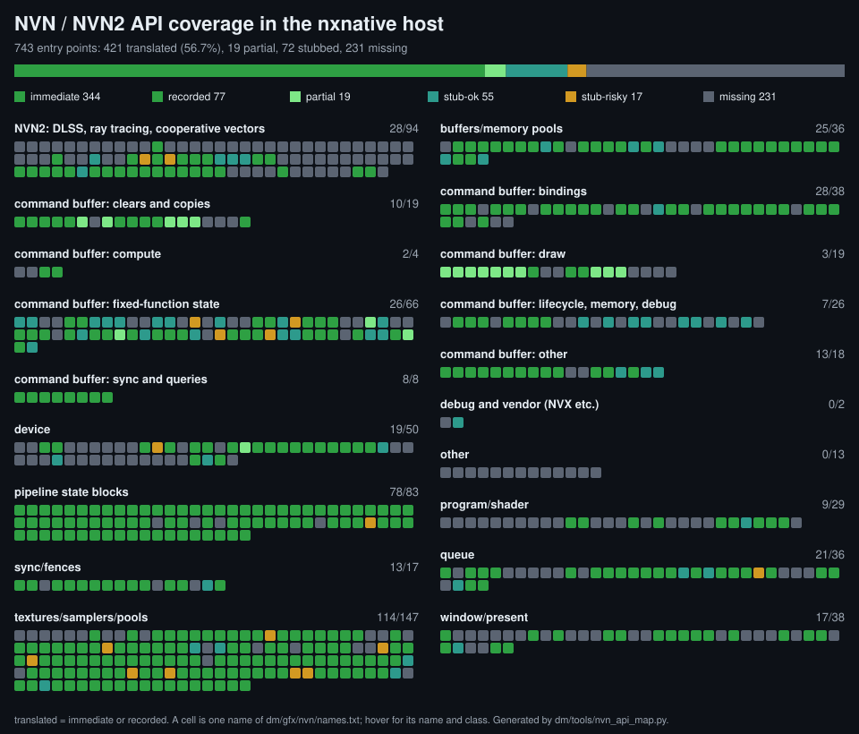

# NVN API coverage



One cell per entry point: strong green is translated (immediate or recorded), light green partial, teal a stub that is safe to ignore, amber a stub that may not be, grey missing. Hover a cell for its name and class. The picture is generated with the table.

How the host handles each NVN / NVN2 entry point, one row per name in `dm/gfx/nvn/names.txt`: [nvn-api.tsv](nvn-api.tsv). It answers "is this call implemented, recorded for the replay, ignored or missing?" without reading `hle_nvn.c`, and it tells a game's translation work which calls to look at first. The idea of a generated, CI-checked coverage map with a status vocabulary follows what other porting projects publish, AnyPS5's progress map being the inspiration; the table, tool and vocabulary here are this repository's own. Entries on how an entry point behaves are in [nvn-objects.md](nvn-objects.md) and [rendering.md](rendering.md).

## The table and how it is kept

`python3 dm/tools/nvn_api_map.py` writes the table and the picture ([nvn-api.svg](nvn-api.svg), a plain SVG with its own dark background; `--svg <file>` writes it elsewhere) and prints the totals; `--check` exits 1, with a diff, when either is not what the sources give. `dm/tools/tests/test_nvn_api_map.py` runs the same check in CI (the tool tests of `tests.yml`), so a change to the NVN layer that moves a call from one class to another comes with the table's new row. It reads only this repository (no game, no GPU) and has no line numbers in it, so an edit that moves a handler does not change the table.

| Column | Where it comes from |
|---|---|
| `name`, `category` | `names.txt`; the category is the object the name belongs to (device, queue, command buffer by what the call does, ...) |
| `class` | see below |
| `op` | the `OP_*` names the handler records (a command buffer call writes an op into the game's command memory; the compact `OPC_*` forms are listed under the op they stand for in the notes) |
| `handler` | the host function (`h_<name>`; `nvn_nop (g_nops)` for an empty implementation); empty for a missing name |
| `replay` | the recorded ops that have a `case` in `mtl_exec` (`nvn_mtl.m`), where the submit replays them |
| `notes` | what the code shows (a stub's kind, "no prototype in nvn.h", the first `[RED]` line a handler can log) and, after `judged:`, the judgment from [nvn-api-judgments.tsv](nvn-api-judgments.tsv) |

### Classes

- **immediate**: a handler that does its work when called (objects, builders, state blocks, getters, queue and window calls). The tool only sees that the body is not a stub: it does not say the work is complete.
- **recorded**: an `nvnCommandBuffer*` handler that writes one or more ops; the GPU work happens at submit, in the replay.
- **partial**: a handler or its replay that works for some inputs. The judgment says which input is not handled and quotes the code's own text for it (the `[RED]` line it logs).
- **stub-ok**: an empty, constant-return or log-only handler (or an entry of `g_nops[]`) where the code states why nothing is lost. The judgment's anchor is that statement.
- **stub-risky**: the same kind of handler where the code says the behaviour is ignored (`ignored by the host for now`, `No Metal equivalent`), or says nothing about why ignoring it is safe (the note then says `not verified`). Risky means unverified, not known wrong.
- **missing**: no handler. A call reaches `nvn_unimpl_c`, which logs `[RED] NVN unimplemented function called: <name>` once per name, returns 0 and lets the game go on; whatever the call was to do is not done.

What the tool detects from the code (no handler, a recorded op, an empty / constant-return / log-only body) is never overridden by hand. What it cannot detect lives in `docs/reference/nvn-api-judgments.tsv` (`name`, `class`, `anchor`, `note`): the class of every stub, and the partial rows. `anchor` is a phrase that must occur in `dm/gfx/nvn` or `docs/reference`, so a judgment whose code was rewritten fails the check. The check also fails for a stub without a judgment, a judgment of a handler that is not a stub any more, a handler no name reaches, and a recorded op with no replay case (`OP_WAIT_EVENT` and `OP_WAIT_SYNC` are the two the queue scheduler consumes first, `nvn_queue.inc`).

A judgment is a reading of the code, not a measurement. A name is `missing` or `stub-risky` whether or not any shipped game calls it.

## A change that touches the table

Implement or remove a handler, run `python3 dm/tools/nvn_api_map.py` and commit the table with the change. A new stub needs a row in `nvn-api-judgments.tsv`: `stub-ok` with the code's own sentence as the anchor, otherwise `stub-risky` and `not verified` in the note. A call that gains a real implementation loses its judgment row.

## A game's list of gaps

The log of a run names what the game called: `[RED] NVN unimplemented function called: <name>` appears once per missing name it reached. To turn logs into a list, with the class and the notes of each name:

```
python3 dm/tools/nvn_api_map.py --gaps --game-log <log file or folder>
```

`--game-names <file>` takes any text in which the called names appear (the call lines of a `DM_NVN_COUNT=1` run), and `--game-binary <main module>` adds the names the game carries as strings; a carried name is listed after the called ones and is not known to be called (a game carries its whole engine's table). The tool prints the missing, partial and stub-risky names, called first. Nothing is written and nothing a game provided is kept in the repository: keep a game's list in its note (`dm/games/<id>/README.md`) as names only.

The `[RED]` lines of partial calls (`primitive type %d not implemented`, `texture clear case not implemented`, ...) are logged by the replay itself; the judgment's anchor is the text to search the log for.

## Totals

Where the table was introduced (`dm/tools/nvn_api_map.py` prints the current ones): 743 names, of which 344 immediate, 77 recorded, 19 partial, 55 stub-ok, 17 stub-risky and 231 missing. 512 names have a handler (every class but missing: 502 `NVN(...)` handlers and 10 `g_nops[]` entries); the host logs the same split at startup (`[nvn] null device: ... implemented ... the other ... go to the red-reporting stub`).
